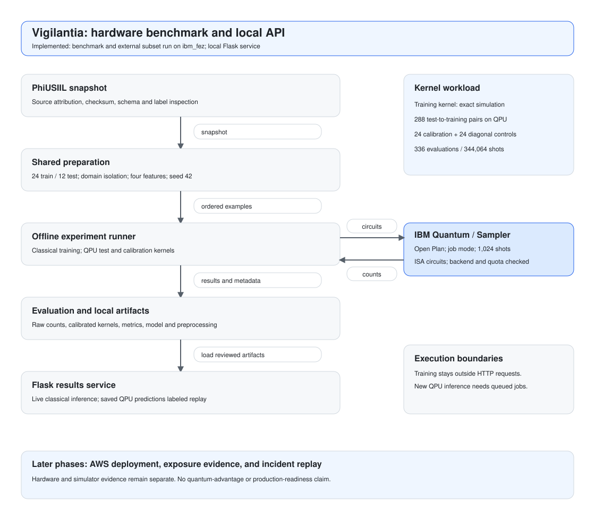
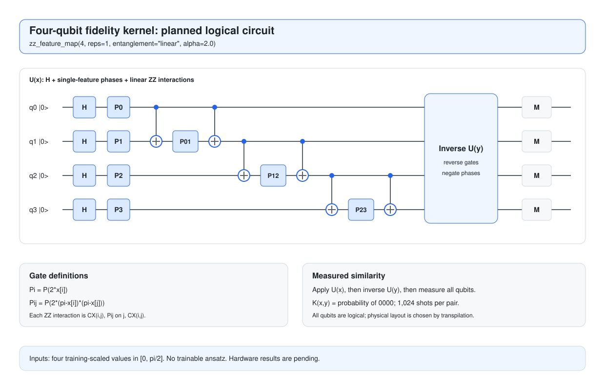

<div align="center">

# Vigilantia
### Financial Security · IBM Quantum + Qiskit · Python + Flask

[](https://www.python.org/)
[](https://flask.palletsprojects.com/)
[](https://github.com/Qiskit/qiskit)
[](https://quantum.cloud.ibm.com/)


**A research prototype for phishing detection and data-exposure evidence triage.**

**Dataset:** PhiUSIIL | **Track:** Quantum Machine Learning | **Event:** Qiskit Fall Fest Hackathon

</div>

---

## Why this project

Financial institutions and fintech security teams must prioritize suspicious websites and data-exposure claims using incomplete evidence. A convincing sample may contain fabricated records, modified information, or material recycled from an earlier incident.

Vigilantia explores whether quantum kernels improve phishing classification under a small training budget. The MVP combines a hardware benchmark on IBM Quantum with classical baselines and a local inference API. A later complementary demonstration will organize evidence from controlled exposure scenarios for analyst review.

**Research question:** Can a quantum-kernel classifier improve phishing detection compared with classical models using the same features, data splits, and tuning budget?

The project measures predictive quality and computational cost. Classical models outperforming the quantum model is a valid outcome. Statistical similarity alone cannot establish the authenticity, source, or authorship of a breach.

---

## Table of Contents

| Section | Description |
| --- | --- |
| [About](#about) | Scope and implementation status |
| [MVP Completion Criteria](#mvp-completion-criteria) | Evidence required for the first working release |
| [Open Decisions](#open-decisions) | Unresolved implementation choices |
| [Capabilities](#capabilities) | Product modules and boundaries |
| [Dataset](#dataset) | PhiUSIIL, labels, and data preparation |
| [Architecture](#architecture) | Planned training and serving paths |
| [Technology Stack](#technology-stack) | Application, ML, and cloud components |
| [Pipeline](#pipeline) | Reproducible data and model lifecycle |
| [Quantum Benchmark Strategy](#quantum-benchmark-strategy) | Fair comparisons and resource controls |
| [Quantum Circuit](#quantum-circuit) | Four-qubit encoding and hardware measurement |
| [Evaluation Metrics](#evaluation-metrics) | Quality, cost, and reporting |
| [API](#api) | Flask results service and proposed routes |
| [Repository Structure](#repository-structure) | Planned modules and responsibilities |
| [Getting Started](#getting-started) | Reproduction guide, setup, and commands |
| [Development and CI](#development-and-ci) | Python checks, tests, and branch protection |
| [Deployment Strategy](#deployment-strategy) | Target AWS infrastructure |
| [Security and Data Handling](#security-and-data-handling) | Input, access, and evidence boundaries |
| [Roadmap](#roadmap) | Delivery checklist |
| [Limitations](#limitations) | Interpretation boundaries |
| [Hackathon Submission](#hackathon-submission) | Deliverables and deadline |
| [Author](#author) | Project identification |
| [License and References](#license-and-references) | Attribution and supporting resources |
| [Related Docs](#related-docs) | Protocol, data guide, contribution, and review checklist |

---

## About

**Current status: first benchmark run complete; local service implemented.** The dataset downloader, the frozen split and features, the four models, the IBM Quantum run tooling, and the Flask service with its Docker image are implemented and unit-tested. The full benchmark ran on `ibm_fez`, and its quality, runtime, and replay are published. Cloud resources are not implemented, and no deployment exists.

| Item | Decision |
| --- | --- |
| Primary task | Binary phishing classification |
| Product context | Financial-sector security and investigation workflows |
| Primary dataset | PhiUSIIL Phishing URL (Website) |
| Positive modeling class | Phishing |
| Quantum approach | Quantum-kernel SVM / QSVC |
| Initial experiment | Four features, four qubits, 24 training and 12 test examples, seed 42 |
| Quantum hardware | IBM Quantum Open Plan, Qiskit Runtime sampler, job mode |
| API | Python and Flask |
| MVP environment | Local API; IBM Quantum hardware for the benchmark |
| Later deployment target | AWS |
| Later complementary scope | Controlled data-exposure evidence demonstration |

## MVP Completion Criteria

- [x] Acquire and attribute the dataset; record checksums, inspection results, and domain-disjoint splits.
- [x] Freeze four ordered features, training-fitted preprocessing, and fixed model settings.
- [x] Compute the training kernel by exact simulation, and obtain the complete test kernel and calibration pairs from IBM Quantum hardware, with job IDs and raw counts.
- [x] Compare majority, logistic regression, RBF SVM, and quantum-kernel SVM on the same examples; publish measured quality and runtime.
- [x] Validate local classical inference for new structured inputs, input errors, and missing/incompatible artifacts.
- [x] Identify any saved QPU predictions exposed in the demo as replay, with sample and source-run metadata.
- [x] Document tested environment setup and reproducible acquisition, experiment, and API commands.

Simulator diagnostics alone do not complete the hardware criterion. Exposure analysis, incident replay, and AWS deployment belong to later phases. See the [benchmark protocol](docs/benchmark-protocol.md) for acceptance checks.

## Open Decisions

- **Python and dependency versions:** resolve compatibility in an isolated environment, run import/circuit/inference checks, then pin the tested environment before benchmarking.
- **Backend and quota:** confirm the accessible Open Plan instance, remaining quota, backend limits, and estimated execution usage before submission; record the selected backend and configuration.
- **Public authentication and AWS limits:** resolve during the later deployment phase, before exposing analysis routes publicly.

These are unresolved decisions, not implemented settings. The initial sample, seed, shots, circuit, and model configurations are defined in the [protocol](docs/benchmark-protocol.md).

## Capabilities

| Module | Planned capability | Boundary |
| --- | --- | --- |
| Phishing Shield | Classify structured website features using classical and quantum models | General phishing benchmark; financial-sector performance requires separate validation |
| Exposure Evidence | Later: inspect consistency and reference-record matches in controlled samples | Deferred from MVP; no proof of real-world breach authenticity |
| Incident Timeline | Later: replay prepared events with source, observation time, evidence, and review status | Deferred from MVP; not live breach discovery |
| Benchmark Reports | Compare predictive quality, variability, and runtime | No claim of quantum advantage before measurement |

The exposure demonstration will cover samples extracted from a fictitious reference database, modified records, older versions, and independently generated records. These are experimental scenarios, not mutually exclusive real-world incident categories. A dedicated exposure classifier is a future extension requiring trustworthy labels.

PhiUSIIL is the only selected training dataset. It does not provide labels for breach authenticity or establish a link between phishing and a subsequent exposure.

---

## Dataset

The original dataset has been acquired and structurally validated locally: 235,795 rows, 56 CSV columns, and class counts matching the published source. The 54-feature count below is the source's feature count, not the total number of CSV columns. Downloaded data is ignored by Git. See the [data guide](data/README.md) for checksums, acquisition, validation limits, and pending feature/split work.

**Selected source:** [PhiUSIIL Phishing URL (Website), UCI Machine Learning Repository](https://archive.ics.uci.edu/dataset/967/phiusiil+phishing+url+dataset).

| Property | Published value |
| --- | --- |
| Instances | 235,795 |
| Legitimate examples | 134,850 |
| Phishing examples | 100,945 |
| Features | 54 |
| Format | CSV, approximately 54 MB uncompressed |
| Original labels | `1 = legitimate`, `0 = phishing` |
| Modeling target | `is_phishing = 1 - label` |
| License | CC BY 4.0 |
| Authors | Arvind Prasad and Shalini Chandra |
| Python retrieval option | `ucimlrepo.fetch_ucirepo(id=967)` |

### Data preparation rules

- Record the acquisition date, source version, file checksum, sampling seed, and attribution.
- Drop `FILENAME` from model inputs. Preserve URL and domain fields for deduplication and grouping, rather than treating them as memorized identifiers.
- Keep equivalent registrable domains in the same split, using a documented Public Suffix List rule. Handle missing or invalid domains explicitly.
- Select four reproducible numerical features using training data only. Freeze their names, ordering, training-fitted scaling to `[0, pi/2]`, and clipping behavior before evaluation and serving.
- Audit similarity, reputation, and derived probability features before use. Their construction must not expose test labels or unavailable inference-time information.
- Fit scaling and feature selection on training rows only. If cross-validation is introduced later, refit transformations inside each training fold.

The dataset contains pre-extracted URL and webpage features. Reproducing the benchmark does not require visiting suspicious URLs. The MVP API will accept structured features; accepting raw URLs later requires a compatible extraction pipeline.

---

## Architecture

The proposed design separates data preparation, offline experiments, and API serving. Both model families share the same feature contract and evaluation protocol.



See [Architecture.md](Architecture.md) for component responsibilities and implementation boundaries.

Training and benchmark jobs run separately from HTTP requests. The local MVP API will use the classical model for new inputs. Saved QPU predictions can be shown as explicitly labeled replay with their sample and source run. Live quantum inference requires additional reference-kernel evaluations and an asynchronous design, which is outside the initial API scope.

### Architectural decisions

| Decision | Benefit | Tradeoff |
| --- | --- | --- |
| Shared feature contract | Comparable classical and quantum experiments | Small feature sets may discard useful signals |
| Offline training | Predictable API workload | Requires artifact versioning and deployment discipline |
| Structured feature inputs | Reproducible inference without arbitrary URL fetching | Not yet a general-purpose URL scanner |
| Deferred exposure demonstration | Keeps the first release focused on the phishing experiment | Evidence workflows are unavailable in the MVP |
| Simulator checks, hardware benchmark | Validate circuit logic locally before collecting QPU measurements | Hardware completion depends on access, quota, and queues |
| Classical training, quantum classification | Halves QPU usage and keeps hardware noise out of the training matrix | The model is fitted to ideal similarities and applied to noisy ones, which requires calibration and a simulated reference |

## Technology Stack

| Layer | Technology | Status |
| --- | --- | --- |
| Language | Python | Selected |
| API | Flask with Jinja templates; Gunicorn in the container | Implemented locally: results, replay, chart, and live prediction |
| Quantum ML | Qiskit and Qiskit Aer; fidelity kernel implemented directly | Implemented |
| Quantum hardware | IBM Quantum; qiskit-ibm-runtime sampler | Full benchmark run on `ibm_fez`; counts recorded |
| Classical ML | scikit-learn | Implemented |
| Data processing | pandas, NumPy, tldextract | Implemented |
| Experiments | Jupyter notebooks | Five reproduction notebooks, executed from a fresh environment |
| Packaging | Docker | Service image builds and runs locally |
| Cloud | AWS | Later deployment target; services proposed below |
| Demo interface | Server-rendered results page and JSON route | Implemented locally; shows results as pending until published |

Every dependency is pinned in the `requirements*.txt` files and was installed from scratch on Python 3.12; see the [reproduction guide](docs/reproducing.md).

---

## Pipeline

| Stage | Planned output | Validation |
| --- | --- | --- |
| Acquire | Immutable PhiUSIIL snapshot and source metadata | Checksum, license, schema, label counts |
| Prepare | Deduplicated rows and domain-group split manifest | No domain overlap across partitions |
| Transform | Versioned feature pipeline | Training-only fitting and target exclusion |
| Train | Classical models and SVM fitted to an exactly simulated quantum kernel | Identical examples and feature inputs |
| Evaluate | Metrics on the test set; quantum SVM classified from QPU-measured kernels | Untouched final test set |
| Package | Model, preprocessing, reference data, and metadata | Artifact compatibility and inference smoke check |
| Serve | Local classical inference and labeled saved QPU predictions | Input contract, model availability, and replay identification |

## Quantum Benchmark Strategy

| Model | Role |
| --- | --- |
| Majority-class classifier | Minimum reference |
| Logistic regression | Linear baseline |
| RBF-kernel SVM | Primary nonlinear baseline |
| Quantum-kernel SVM / QSVC | Experimental classifier |

Start with **four features, four qubits, 24 training examples, 12 test examples, seed 42, and 1,024 shots per circuit**. Seek balanced classes while preserving domain isolation. Use identical examples and transformations for all models.

1. Reserve a domain-disjoint final test set before model selection.
2. Freeze the small split and report its groups and class distribution.
3. Fit preprocessing on training rows only; clip test/inference values using that saved transformation.
4. Use the fixed model settings in the protocol, with no tuning or test-based threshold selection.
5. Compute the training kernel by exact simulation, then collect the QPU test and calibration kernels before final evaluation, retaining raw measurements and calibration parameters.
6. Report all models and disclose that this first run has one seed and no fold/seed variability estimate.

The training kernel requires pairwise comparisons, so its matrix grows quadratically with the training sample count. This is why the benchmark uses a hybrid design: training is classical, on an exactly simulated kernel, and the QPU is used for classification. Cache only configuration-compatible kernels and record sample counts, circuit depth, qubits, backend, shots when applicable, and execution time.

The initial hardware workload is **288 test-to-training pairs + 24 calibration pairs + 24 diagonal controls = 336 evaluations**, totaling **344,064 requested shots**. The same quantum SVM is reported on the ideal, raw hardware, and calibrated hardware test kernels. Check quota and estimated execution usage before submission. Use Open Plan job mode; insufficient quota or unfinished jobs leave the benchmark pending. Hardware classification is required, and simulator results cannot replace it. See the [complete protocol](docs/benchmark-protocol.md) for matrix processing, runtime evidence, and failure handling.

## Quantum Circuit



Use `zz_feature_map(4, reps=1, entanglement="linear", alpha=2.0)`. Encode four scaled values, apply the inverse map for a second example, and measure the probability of `0000` to estimate their fidelity kernel. Linear connections are 0–1, 1–2, and 2–3. The circuit contains no trainable ansatz; the SVM is fitted classically to the simulated kernel and classifies the test set from the hardware-measured kernel. See the [circuit specification](docs/quantum-circuit.md).

## Evaluation Metrics

| Metric | Purpose |
| --- | --- |
| PR-AUC / average precision | Ranking quality for the phishing class; specify the exact definition used |
| Precision and recall | False-alert burden and phishing detection coverage |
| Accuracy | Share of correct test classifications; reported with balanced accuracy because 12 test examples make it coarse |
| F1 and balanced accuracy | Threshold-dependent classification comparison |
| Confusion matrix | Explicit false positives and false negatives |
| Training and inference runtime | Computational cost and serving feasibility |
| Fold and seed variability | Later extension; unavailable in the initial single-seed run |

**Results: complete for the first run.** All results are recorded in the [benchmark protocol](docs/benchmark-protocol.md#recorded-results) and published in `reports/benchmark-results.json`. The RBF SVM scored highest, at 11 of 12. The quantum-kernel SVM scored 6 of 12, chance level, with the simulated kernel and with the kernels measured on `ibm_fez`, uncorrected and calibrated; hardware noise changed no prediction. With 12 test examples, every estimate here is unstable. Every model fits and predicts in milliseconds locally; measuring the hardware test kernel took 89.2 s of QPU execution. No advantage claim is made. Reports must include class prevalence, split definitions, thresholds, feature choices, and runtime conditions. Scores will not be described as probabilities without appropriate calibration and evaluation.


The chart shows test accuracy per model with the source of each result, the measured kernel error against the exact simulation, and the IBM Quantum time used. The full 336-circuit run on `ibm_fez` billed 92 s of the Open Plan's 600 s, matching the pilot's projection of 89 s of execution time. Its test kernel error was 0.037 uncorrected and 0.029 calibrated, about three times the fake-backend rehearsal. `scripts/render_results_svg.py` regenerates the chart from the recorded results.

---

## API

**MVP routes implemented.** The Flask service in `app/` reads the [published results and replay files](reports/README.md), validates them on every request, and reports them as pending until they exist. Live prediction loads the trained classical model on first use; without the model artifacts it answers `503 model_unavailable` while the rest of the service keeps working. Request bodies are limited to 2 KB, and the content security policy allows no scripts.

| Method | Route | Planned behavior |
| --- | --- | --- |
| `GET` | `/health` | Application liveness |
| `POST` | `/v1/phishing/predict` | Implemented: `{"host": "..."}` returns the RBF SVM prediction, decision margin, features, out-of-range features, and model version; `400` for invalid input, `503` without model artifacts |
| `POST` | `/v1/exposure/analyze` | Later phase: consistency and reference-match checks on controlled samples |
| `GET` | `/v1/incidents` | Later phase: demonstration incidents and review states |
| `GET` | `/v1/benchmarks` | Implemented: return validated recorded results, `503` while pending, `500` for an invalid file |
| `GET` | `/v1/benchmarks/replay` | Implemented: recorded quantum-kernel SVM test predictions per source, labeled replay, with source runs |
| `GET` | `/benchmark.svg` | Implemented: the generated benchmark chart |
| `GET` | `/` | Implemented: host form, results page with chart and sources, and the replay table |

The features are computed from the host alone; the page is never fetched. Invalid input and unavailable artifacts are distinguishable from a classification result. Saved quantum benchmark predictions belong to recorded benchmark results and must identify their sample and run as replay. Training and hardware benchmark jobs will not run inside prediction requests. The later exposure module will return evidence observations, not authentication verdicts.

## Repository Structure

Current checkout:

```text
Vigilantia/
├── .github/
│   ├── rulesets/
│   │   └── protected-branches.json
│   ├── workflows/
│   │   └── ci.yml
│   └── dependabot.yml
├── app/
│   ├── templates/
│   │   └── index.html
│   ├── __init__.py
│   ├── replay.py
│   └── results.py
├── configs/
│   ├── benchmark-split.json
│   └── feature-scaler.json
├── data/
│   └── README.md
├── docs/
│   ├── architecture-flow.svg
│   ├── benchmark-protocol.md
│   ├── benchmark-results.svg
│   ├── ci-and-branch-protection.md
│   ├── documentation-checklist.md
│   ├── quantum-circuit.md
│   ├── quantum-circuit.svg
│   └── reproducing.md
├── notebooks/
│   ├── 01-data-and-split.ipynb
│   ├── 02-features-scaling-and-kernel.ipynb
│   ├── 03-training-and-simulated-evaluation.ipynb
│   ├── 04-ibm-hardware-results-from-recorded-counts.ipynb
│   └── 05-live-inference-runtime-and-service.ipynb
├── reports/
│   ├── qpu-evidence/
│   │   ├── full-ibm_fez-20261025T094010Z/
│   │   └── pilot-ibm_fez-20261025T092140Z/
│   ├── benchmark-replay.json
│   ├── benchmark-results.json
│   └── README.md
├── scripts/
│   ├── check_ibm_access.py
│   ├── check_repository.py
│   ├── download_dataset.py
│   ├── evaluate_benchmark.py
│   ├── predict_host.py
│   ├── prepare_benchmark.py
│   ├── publish_replay.py
│   ├── rehearse_hardware.py
│   ├── render_results_svg.py
│   ├── run_qpu.py
│   ├── scale_benchmark.py
│   ├── time_benchmark.py
│   └── train_benchmark.py
├── src/
│   ├── config/
│   │   ├── env_file.py
│   │   └── ibm.py
│   ├── data/
│   │   └── benchmark_split.py
│   ├── evaluation/
│   │   ├── inputs.py
│   │   ├── metrics.py
│   │   ├── publish.py
│   │   ├── replay.py
│   │   └── runtime.py
│   ├── features/
│   │   ├── host_features.py
│   │   └── scaling.py
│   ├── inference/
│   │   └── predictor.py
│   ├── models/
│   │   └── benchmark_models.py
│   └── quantum/
│       ├── hardware.py
│       ├── kernel.py
│       └── qpu_run.py
├── tests/
│   ├── unit/
│   │   ├── test_app_inference_replay.py
│   │   ├── test_benchmark_split.py
│   │   ├── test_check_ibm_access.py
│   │   ├── test_download_dataset.py
│   │   ├── test_download_dataset_cli.py
│   │   ├── test_hardware_and_metrics.py
│   │   ├── test_notebooks.py
│   │   ├── test_predictor.py
│   │   ├── test_qpu_evidence.py
│   │   ├── test_qpu_run.py
│   │   ├── test_quantum_kernel.py
│   │   ├── test_render_results_svg.py
│   │   ├── test_repository_checks.py
│   │   ├── test_requirements.py
│   │   ├── test_results_app.py
│   │   ├── test_runtime.py
│   │   └── test_scaling.py
│   └── README.md
├── .dockerignore
├── .env.example
├── .gitattributes
├── .gitignore
├── Architecture.md
├── CONTRIBUTING.md
├── Dockerfile
├── LICENSE
├── pyproject.toml
├── README.md
├── requirements-app.txt
├── requirements-dev.txt
├── requirements-model.txt
└── requirements.txt
```

**Responsibilities.** `src/exposure/` and `infra/` are planned for later phases and do not exist yet.

| Path | Responsibility |
| --- | --- |
| `app/` | Flask application, routes, and templates |
| `src/data/` | Acquisition, validation, deduplication, and splits |
| `src/features/` | Transformations and feature selection |
| `src/models/` | Classical and quantum model adapters |
| `src/exposure/` | Controlled evidence checks |
| `notebooks/` | Reproduction notebooks: assumptions, replication checks, and interpretation |
| `configs/` | Experiment configurations and seeds |
| `reports/` | Metrics, plots, and limitations |
| `infra/` | AWS deployment definitions |
| `Dockerfile` | Application image |

## Getting Started

### Reproduce everything

The [reproduction guide](docs/reproducing.md) is the tested path for evaluators: install the pinned environment in a fresh Python 3.12 virtual environment, then run the five [notebooks](notebooks/) in order. They rebuild the dataset snapshot, split, scaler, models, simulated results, and IBM hardware results from the recorded counts, and check every value against the published files. No IBM account is needed. The sections below describe the individual commands.

### Download the dataset

```powershell
python scripts/download_dataset.py
```

This command uses only the standard library and writes the original ZIP, CSV, and `acquisition.json` to `data/raw/`. It can run before installing runtime dependencies. Repeating it verifies and reuses an intact snapshot without a new download. Partial or modified snapshots fail with an explanation and are preserved. The [data guide](data/README.md) explains recovery and validation boundaries.

### Run the Flask service

The Flask service needs the pinned dependencies in `requirements-app.txt`. Until the results and replay files exist, the page and the JSON routes report them as pending. Live prediction needs the trained models in `artifacts/benchmark/`, produced by `scripts/train_benchmark.py`.

```powershell
python -m pip install -r requirements-app.txt
python -m flask --app "app:create_app()" run --port 8000
```

Or build and run the container, which serves on port 8000 with Gunicorn as a non-root user:

```powershell
docker build -t vigilantia .
docker run --rm -p 8000:8000 -v "${PWD}/artifacts/benchmark:/srv/vigilantia/artifacts/benchmark:ro" vigilantia
```

The image contains the code, the fitted scaler, the published results, the replay, and the chart, but not the trained models; the read-only mount provides them. Without the mount, prediction answers `503`. Open `http://127.0.0.1:8000/`. `VIGILANTIA_RESULTS_PATH`, `VIGILANTIA_REPLAY_PATH`, and `VIGILANTIA_CHART_PATH` override the file locations. After a new evaluation, refresh the replay with `scripts/publish_replay.py`.

### Build the benchmark sample

Use a Python 3.12 environment for modeling; Qiskit Aer may not support newer versions yet.

```powershell
py -3.12 -m venv .venv-qml
.\.venv-qml\Scripts\python.exe -m pip install -r requirements-dev.txt
.\.venv-qml\Scripts\python.exe scripts/prepare_benchmark.py
```

The script checks the CSV checksum, then writes `configs/benchmark-split.json` and the local `data/processed/benchmark-sample.csv`. Then fit the training-only angle scaler:

```powershell
.\.venv-qml\Scripts\python.exe scripts/scale_benchmark.py
```

It writes `configs/feature-scaler.json` and the local `data/processed/benchmark-scaled.csv`. Then build the simulated training kernel and fit the four models; no test data is read:

```powershell
.\.venv-qml\Scripts\python.exe scripts/train_benchmark.py
```

Fitted models, the training kernel, and a summary go to the ignored `artifacts/benchmark/` directory. Then classify the test set with the simulated kernel, and rehearse the hardware path on a local fake backend:

```powershell
.\.venv-qml\Scripts\python.exe scripts/evaluate_benchmark.py
.\.venv-qml\Scripts\python.exe scripts/rehearse_hardware.py
```

The first writes the published `reports/benchmark-results.json`, with status partial until QPU results exist. The second uses no IBM account and writes only local diagnostics. See the [benchmark protocol](docs/benchmark-protocol.md) for the rules. Regenerate the results chart after any new evaluation:

```powershell
.\.venv-qml\Scripts\python.exe scripts/render_results_svg.py
```

### Configure IBM Quantum access (optional)

Only new hardware runs need an IBM Quantum account; the [reproduction guide](docs/reproducing.md) rebuilds the published hardware results from the recorded counts without one. [.env.example](.env.example) documents the settings. Create a local `.env` from it once:

```powershell
Copy-Item .env.example .env
```

On macOS/Linux, use `cp .env.example .env`.

The `.env.example` entries are commented out deliberately. `scripts/check_ibm_access.py` reads `IBM_QUANTUM_TOKEN`, `IBM_QUANTUM_INSTANCE`, and `IBM_QUANTUM_BACKEND` from `.env` and passes them to the SDK; variables set in the terminal session take precedence, and a saved Qiskit account is used when no token is set. These are not automatic SDK environment variables. The check submits only a dry run, which IBM validates without executing on a QPU:

```powershell
.\.venv-qml\Scripts\python.exe scripts/check_ibm_access.py
.\.venv-qml\Scripts\python.exe scripts/check_ibm_access.py --full-workload
```

The second form dry-runs all 336 benchmark circuits and prints IBM's estimate of the QPU time they would use. Dry runs depend on IBM making a mock backend available; for the current Open Plan account they are not, which says nothing about real jobs.

### Classify new hosts

Classify hosts or URLs with the served classical model. Only the host is used, and nothing is fetched or visited:

```powershell
.\.venv-qml\Scripts\python.exe scripts/predict_host.py example.com https://login-check.web.app/
```

Each result includes the prediction, the SVM decision margin, the four features, any feature outside the training range, and a model version derived from the artifacts. The served model is the RBF SVM, named the primary nonlinear baseline before any test result existed; `--model logistic_regression` is also available. The margin is not a probability. The quantum-kernel SVM is not served live, because each prediction would need QPU kernel evaluations.

### Run the benchmark on IBM Quantum hardware

These commands use real QPU quota. Set `IBM_QUANTUM_BACKEND` in `.env` first, for example `ibm_fez`, so every circuit runs on the same device. `submit` checks the instance quota, transpiles for that backend, and asks you to type `SUBMIT` before sending anything:

```powershell
.\.venv-qml\Scripts\python.exe scripts/run_qpu.py submit --pilot 12
.\.venv-qml\Scripts\python.exe scripts/run_qpu.py retrieve <run-id>
.\.venv-qml\Scripts\python.exe scripts/run_qpu.py evaluate <run-id>
```

The pilot sends 12 circuits and `evaluate` reports their QPU time and a projection for the full run. If the projection fits the remaining quota, submit the full run with `submit` and no `--pilot`, then retrieve and evaluate it. `retrieve` can be repeated while jobs are queued; it never resubmits. `evaluate` of a full run calibrates the hardware kernel, classifies the test set, and publishes `reports/benchmark-results.json` with the QPU rows. `list` shows recorded runs. Run records, job IDs, and raw counts are kept in the ignored `artifacts/benchmark/qpu-runs/` directory.

After `evaluate`, add measured runtimes to the published file. This is local and makes no IBM call; hardware rows reuse the execution time IBM recorded for the run:

```powershell
.\.venv-qml\Scripts\python.exe scripts/time_benchmark.py
```

It times fit, test-kernel computation, and prediction for every row, as the median of 25 repeats, and records the machine and package versions. A new `evaluate` rewrites the results file without runtimes, so run it again afterwards.

Local `.env` variants and project-local provider credential files are ignored by Git; the example remains versionable. Keep real secrets out of the example.

Before the first runnable release, validate the supported Python version and package compatibility, pin dependencies, and document dataset retrieval, API startup, and benchmark commands. Local simulator experiments should be reproducible independently of cloud deployment.

Required resources for the planned workflow are a compatible Python environment, the selected dataset, local simulator resources, and IBM Quantum Open Plan access with sufficient available quota for the hardware benchmark. No IBM credentials are needed for local simulator checks. AWS access and Docker belong to the later deployment phase.

---

## Development and CI

Development tooling is configured in `pyproject.toml`; `requirements-dev.txt` adds pytest and Ruff to the complete pinned environment. GitHub Actions runs Ruff (including the notebooks), Pytest, and offline repository checks on Python 3.12 and 3.13 for PRs and pushes to `develop` and `main`. The unit tests cover data preparation, features, the quantum kernel and hardware tooling with stubbed IBM services, models, evaluation, inference, the Flask service, requirements, recorded QPU evidence, and notebook hygiene. CI does not execute the notebooks, because that needs the UCI download; the [reproduction guide](docs/reproducing.md) records their tested run.

Use feature branches targeting `develop`, then a PR from `develop` to `main`. The importable ruleset requires the stable **CI required** check and PRs, and blocks force-push and deletion. **Remote branch protection is not activated by these files.** See [CI and branch protection](docs/ci-and-branch-protection.md) for local commands, activation instructions, and current limitations; see [tests/README.md](tests/README.md) for test conventions.

## Deployment Strategy

**Later target environment: AWS. Infrastructure has not been provisioned, and no deployment has been run.** The results service is containerized and ready to deploy. The planned path is Amazon ECS Express Mode, which runs the container on Fargate behind a managed HTTPS load balancer with a URL of the form `https://<service>.ecs.<region>.on.aws`. AWS App Runner is not used because it closed to new customers on April 30, 2026; AWS recommends Express Mode as its replacement.

| Service | Proposed responsibility |
| --- | --- |
| Amazon ECR | Docker image registry |
| Amazon ECS Express Mode on AWS Fargate | Results service container; separate benchmark tasks later |
| Application Load Balancer | HTTPS entry point, provisioned and managed by Express Mode |
| Amazon S3 | Private datasets, model artifacts, and reports |
| Amazon DynamoDB | Optional persistent incident metadata and review state |
| Amazon CloudWatch | Operational logs and metrics |
| AWS IAM | Least-privilege task permissions |

The initial demo can replay incidents from prepared files without DynamoDB. Service selection and resource sizing remain subject to the available budget and implementation time.

Deployment sequence:

1. Validate the local pipeline and pin dependencies.
2. Build the Docker image and publish it to ECR.
3. Configure private S3 storage and task roles.
4. Deploy the API service and HTTPS entry point.
5. Run benchmarks separately and package selected artifacts with their feature pipeline and metadata.
6. Verify inference, access control, artifact compatibility, and operational logs.
7. Set resource limits and cost alerts, and document teardown after the demonstration.

### Non-functional requirements

| Category | Planned requirement |
| --- | --- |
| Reproducibility | Versioned input snapshot, split manifest, seed, feature schema, and artifacts |
| Reliability | Explicit failures for incompatible or missing artifacts |
| Observability | Request ID, model version, latency, and outcome without sensitive payload logging |
| Security | Private storage, least-privilege IAM, input limits, and protected analysis routes |
| Cost | Bounded experiment sizes and separate training tasks |

## Security and Data Handling

- Use appropriately licensed public data for phishing research and fictitious records for the exposure laboratory.
- Keep credentials, personal records, and real breach samples out of the repository, logs, and demonstration video.
- Validate input size and schema, protect analysis routes before public exposure, and define artifact retention.
- Do not fetch arbitrary user-provided URLs in the MVP.
- Keep operational secrets outside source code and use task roles for AWS access.
- Present correlations as investigation leads. Require human review before actions affecting customers or accounts.

Tests should cover target mapping, domain isolation, training-only preprocessing, feature ordering, invalid input, and missing model artifacts. CI results will be documented once an implementation exists.

---

## Roadmap

- [x] Define the financial-security use case and QML track.
- [x] Select PhiUSIIL and identify its published CC BY 4.0 license.
- [x] Select Python, Flask, Qiskit, and IBM Quantum Open Plan; retain AWS as a later target.
- [x] Document the initial four-qubit circuit and 24/12 hardware benchmark protocol.
- [x] Acquire the original data; record attribution, checksums, structural checks, and class counts.
- [x] Inspect feature provenance, duplicates, and domain quality; exclude collection shortcuts.
- [x] Freeze the domain-disjoint 24/12 split and four host-only features.
- [x] Adopt the hybrid design: classical training on a simulated kernel, quantum classification on hardware.
- [x] Implement the simulated training kernel and fit the four fixed models.
- [x] Classify the test set with the simulated kernel and publish partial results.
- [x] Implement hardware kernel acquisition and rehearse it on a fake backend.
- [x] Collect the complete QPU test and calibration kernels and preserve job/result evidence within the verified Open Plan quota.
- [x] Produce reproducible metrics, plots, and runtime comparisons.
- [x] Implement the Flask results service, its container image, and its unit tests.
- [x] Implement live classical inference for new hosts, with a command-line entry point.
- [x] Implement and validate the Flask inference route.
- [x] Show the benchmark chart in the Flask results page.
- [x] Validate classical live inference and clearly labeled saved quantum predictions.
- [x] Complete notebooks and verified environment instructions.
- [x] Include the MIT code license.
- [ ] Publish the repository, record the demo, and submit.
- [ ] Later: build the controlled exposure and incident replay demonstration.
- [ ] Later: package and deploy on AWS with authentication and resource limits.

Delivery priority: data inspection, frozen protocol, local circuit checks, QPU acquisition, fair comparison, and local API. Exposure workflows and AWS deployment follow the MVP.

## Limitations

- Historical phishing data does not establish performance against current attacks or banking-specific campaigns.
- Small samples increase uncertainty; feature reduction may remove useful signals.
- The quantum SVM is trained on ideal similarities and classifies with noisy hardware ones. Calibration is a linear approximation, and no model trained on hardware measurements is evaluated.
- PhiUSIIL has collection shortcuts: every legitimate URL is a bare `https://www.` homepage. The benchmark uses only host-based features, but those still reflect how the data was collected.
- Simulator results do not establish quantum speedup or production readiness.
- PhiUSIIL cannot validate breach authenticity. Controlled exposure scenarios only test the stated laboratory checks.
- Exposure experiments must separate source databases and their variants across splits; recognizing generator artifacts is not proof of authenticity.
- Incident replay does not provide continuous monitoring or establish causality between phishing and exposure.

## Hackathon Submission

The following event details were supplied in the project brief and have not been independently verified. Confirm the deadline, track, and submission requirements with the organizers before submitting.

| Item | Detail |
| --- | --- |
| Event | Qiskit Fall Fest Hackathon |
| Proposed track | Track 2 — Quantum Machine Learning |
| Deadline provided by organizers | October 25, 2026, 16:00 UTC / 13:00 America/Sao_Paulo |
| Required deliverables | Public repository, open-source license, README, environment instructions, explanatory notebooks, and a 1–3 minute demo video |
| Submission | Email team details, track, GitHub link, and demo video to `submission@aiqtlab.com`; confirm receipt in the submissions channel |

## Author

**Guilherme Lossio** — [GitHub](https://github.com/GuilhermeLossio)

Project: **Vigilantia**.

## License and References

**Code license: [MIT](LICENSE).** The repository already includes the MIT license. PhiUSIIL is distributed under CC BY 4.0; retain its attribution. Reused code and data remain subject to their respective licenses.

- [PhiUSIIL — UCI Machine Learning Repository](https://archive.ics.uci.edu/dataset/967/phiusiil+phishing+url+dataset), Arvind Prasad and Shalini Chandra.
- [Qiskit Machine Learning — Quantum Kernel Tutorial](https://qiskit-community.github.io/qiskit-machine-learning/tutorials/03_quantum_kernel.html).
- [Qiskit Machine Learning Repository](https://github.com/qiskit-community/qiskit-machine-learning).
- [Xanadu — qml-benchmarks](https://github.com/XanaduAI/qml-benchmarks).


## Related Docs

- [Architecture.md](Architecture.md): planned components, data flow, and implementation gaps.
- [docs/](docs/): version-controlled SVG diagrams.
- [LICENSE](LICENSE): MIT code license.
- [Reproduction guide](docs/reproducing.md): tested setup, notebooks, and commands to rebuild every result.
- [Benchmark protocol](docs/benchmark-protocol.md): fixed comparison, hardware budget, and reporting.
- [Quantum circuit](docs/quantum-circuit.md): encoding, fidelity measurement, and execution design.
- [Data guide](data/README.md): attribution, acquisition, storage, and inspection status.
- [Contributing](CONTRIBUTING.md): branches, PRs, validation, and data handling.
- [Documentation checklist](docs/documentation-checklist.md): review before the initial commit.
- [CI and branch protection](docs/ci-and-branch-protection.md): workflow, local checks, and ruleset activation.
- [Tests](tests/README.md): unit-test scope and future application tests.
