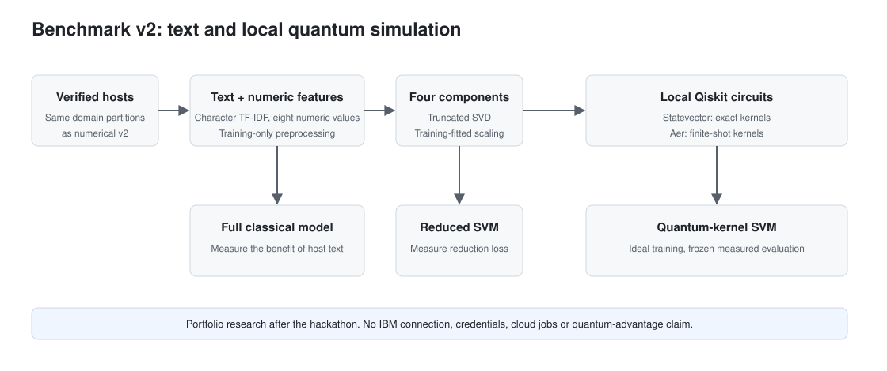

# Benchmark v2 expansion: hostname text and local Qiskit

This is a post-hackathon portfolio study, not a new hackathon submission. It extends v2 while preserving the original hardware benchmark and both numerical v2 runs. Its question is whether a better hostname representation survives compression to four components and benefits from a quantum fidelity kernel.



## Why there is a second model experiment

The original benchmark answered a deliberately small hardware question: four host features, 24 training examples, 12 test examples, and recorded IBM Quantum kernels. That experiment demonstrated a reproducible hybrid workflow; it did not establish useful general phishing detection. Its small test set and collection artifacts limited the conclusions.

The numerical v2 separated development, threshold calibration and test groups; increased training to 2,000 examples; compared four and eight features; searched parameters; and measured variability across three training seeds. The [verified rerun](../reports/benchmark-v2-20261028-093841.json) selected an eight-feature RBF SVM. Internal recall was 57.33% at 9.69% false positives, while external recall was 46.09% at 20.15% false positives. The exploratory target of 80% recall at no more than 10% false positives was not reached. The current [benchmark v2](benchmark-v2.md) has since been rewritten around page-content features; this study keeps the host-only run above as its reference, and its v2 source hashes refer to the earlier code, so a rerun needs a new run ID.

Moving from 500 to 2,000 training examples brought little additional internal recall. Error analysis showed strong dependence on superficial signals: for seed 42, 84.5% of legitimate external hosts containing hyphens were false alarms. This motivated learning character patterns instead of relying only on counts and entropy. It did not justify claiming that more qubits or a hardware rerun would solve the problem.

This expansion keeps the name **benchmark v2**, adding a text-and-Qiskit phase rather than silently replacing earlier results or claiming a third production model. The application still serves its original model. The portfolio contribution is the investigation, its reproducibility and its honest treatment of negative results.

## Representation and fair comparisons

Verified source CSVs are used to recover normalized hosts. Preparation reconstructs the same 60/20/20 domain partitions and confirms counts, phishing counts, ordered membership hashes and, when available, the original row indices, labels and group hashes. It fails if recovery differs from the chosen reference. The historical twelve test groups remain excluded.

Balanced, nested training samples contain 24 and 100 examples with seeds 42, 43 and 44. TF-IDF uses character n-grams of length 3–5, minimum document frequency 1, sublinear frequency, L2 normalization and at most 20,000 learned text features. Eight numeric features are standardized and normalized as their own L2 block. The text and numeric blocks receive equal weights, each multiplied by the square root of 0.5.

`TruncatedSVD` learns four components from the combined sparse representation. Training component minima and maxima scale the result to `[0, 1]`, clipping out-of-range evaluation values; a training-constant component maps to zero. Diagnostics report explained variance, component ranges, clipped rows and shifts in constant components. The vocabulary, scaling and SVD are fitted only on the training part of each validation fold. There is no fallback to another representation if the vocabulary is empty, too small or numerically degenerate.

Six classical paths are trained for every sample size and seed: majority baseline; eight-feature numeric RBF SVM; full text/numeric logistic regression; full text/numeric linear SVM; four-component linear SVM; and four-component RBF SVM. The numeric reference uses standardized original numeric values, matching the numerical v2 preprocessing. Classical reduced models receive the same normalized four components used by the quantum encoding.

Three-fold stratified validation maximizes mean average precision (AP). Linear paths search C values 0.1, 1 and 10. RBF paths cross these with gamma values `scale`, 0.01, 0.1 and 1. Quantum search crosses Z/ZZ, angle maxima π/4 and π/2, and the same three C values. Thus RBF and quantum paths each search twelve candidates; linear paths search three. Exact ties use configuration order, not elapsed training time.

For each fitted model, a separate full calibration partition selects the threshold maximizing recall with false positive rate (FPR) ≤ 10%; ties favor lower FPR and higher thresholds. Scores equal to a finite threshold are positive. A null threshold means predict no positives. The majority baseline keeps its fixed class decision. Classical and quantum winners are selected separately using mean calibration recall across seeds, then AP, smaller training size and model name. Selection and training-record hashes are frozen before evaluation datasets are opened.

The report tests three distinct questions: full text versus the same-size numeric baseline; four-component versus full linear SVM; and quantum versus the same-size reduced RBF. The full-text comparison candidate is chosen on calibration, while the reduction comparison uses the largest configured training size. These comparisons avoid picking favorable models from test results.

## What runs in Qiskit

The original numerical v2 computes analytic Z/ZZ state amplitudes in NumPy and checks them against Qiskit in tests. **This expansion constructs and binds actual four-qubit Qiskit circuits and calls `Statevector.from_instruction` for every unique encoded input.** Both Z and linearly entangled ZZ have one repetition and alpha 2. Computed states are cached using circuit settings, representation identity, input shape and exact input bytes; run identity also locks source code and package versions.

The training matrix is the exact fidelity kernel. A conventional SVM is fitted to that matrix. For full internal and external continuity evaluation, exact Qiskit test-to-training kernels provide the scores.

The measurement stage uses **local `AerSimulator` only**, with compute-uncompute circuits and 1,024 shots per pair. It has no physical-device noise model, provider connection or runtime service. Training still uses the ideal kernel: measured kernels are passed to the same SVM with the same ideal-calibrated threshold. No retuning is done after observing measurements.

Before training, preparation fixes 40 internal and 40 external examples, 20 per class, using subset seed 2026. Each quantum model selected within a training size and seed is measured on those same subsets. The default workload is 29,760 pair evaluations: three training seeds times 80 evaluation rows times (24 + 100) references, each with 1,024 shots. Aer executes batches of 128 pairs; simulator seeds are recorded per batch. Cached completed batches retain counts, pair order and checksums. The ideal and measured results are compared on identical subset rows, not against full-set metrics.

One measurement realization per fitted training seed cannot estimate the full distribution of shot noise. Small balanced subsets have wide uncertainty and different class prevalence from the full continuity datasets. Neither Aer results nor CPU timings establish hardware performance or quantum advantage.

## Reproduce locally

Use Python 3.12 and the existing pinned `requirements-dev.txt` environment. The datasets must already be present and verified by the project's dataset downloaders. No new dataset acquisition is part of this experiment. Run commands from the project root:

```powershell
$python = ".\.venv-qml\Scripts\python.exe"
$runId = "text-" + (Get-Date -Format "yyyyMMdd-HHmmss")

& $python -m pip check
& $python scripts/run_benchmark_v2_text.py prepare --run-id $runId
& $python scripts/run_benchmark_v2_text.py classical --run-id $runId
& $python scripts/run_benchmark_v2_text.py statevector --run-id $runId
& $python scripts/run_benchmark_v2_text.py shots --run-id $runId
& $python scripts/run_benchmark_v2_text.py report --run-id $runId
```

Run stages sequentially: they share fold/representation caches. `all --run-id $runId` performs those stages in order and stops after `report`. `--config <path>` accepts an explicit configuration with the same schema. `prepare` and `all` can generate an ID if none is supplied; later stages require the printed ID to resume the correct run.

An independent, explicit command publishes a completed study to the delimited README block:

```powershell
& $python scripts/run_benchmark_v2_text.py publish --run-id $runId
```

This command verifies report and chart hashes and is idempotent. It changes only the marked study block, updating date, model, accuracy, recall, FPR and links from the same report. It does not rewrite historical results or change the Flask service. Malformed markers, incomplete runs, or modified charts stop publication.

Artifacts are stored under `artifacts/benchmark-v2-text/<run-id>/`; aggregate reports under `reports/benchmark-v2-text/<run-id>.json`; charts under `docs/benchmark-v2-text/<run-id>-*.svg`. All local hosts, vocabularies, model pickles, transforms, per-row predictions and raw counts remain in ignored artifacts. Published JSON contains aggregates, identities and evidence hashes. Models are loaded only from trusted, checksum-verified local bundles.

Resume requires unchanged datasets, reference protocol, configuration, source code and Python/package versions. Completed representations, training bundles, scores, states and measurements are hash-checked. Unfinished training can be retried; completed training is reused. Once selection is frozen, search cannot be reopened. Preparation interrupted before its final identity requires a fresh ID. Full report generation can be repeated without changing the frozen models or thresholds.

## Reports and uncertainty

The schema-version-1 report identifies this as `benchmark-v2-text-qiskit-local`. It records all model trials, deterministic tie decisions, fitted-representation diagnostics, clipping, calibration and evaluation metrics, subgroups, elapsed times, exact versus measured kernels, prediction flips and evidence checksums. Every summary includes the mean and population standard deviation across fitted training seeds.

AP measures ranking independently of the decision threshold. Confusion matrices are `[[TN, FP], [FN, TP]]`, with phishing positive. Subgroup rates that cannot be estimated because a class is absent are null, including balanced accuracy in that case.

The study uses 2,000 shared row-bootstrap resamples for 95% percentile intervals on paired comparisons, including conditional measured-minus-ideal differences. These intervals describe test-row uncertainty conditional on the fitted models and realized shot samples. They do not replace seed dispersion or quantify variance over independent quantum measurement repetitions.

The primary target is achieved only if each fitted seed of the selected classical configuration meets both point targets internally. External results are reported separately. Hypothesis assessments use paired AP-difference intervals: positive, negative or inconclusive. All current test sets are explicitly continuity evaluations because their previous results influenced research choices. Fresh independently collected, preferably temporal data remains necessary for a stronger generalization claim.

## Notebook and checks

[Notebook 08](../notebooks/08-text-representation-and-local-qiskit.ipynb) demonstrates a reduced, synthetic text/SVD/classifier/Qiskit/Aer workflow without fetching data, then reads the full measured study report. Synthetic demonstration results are clearly separate from dataset evaluation.

```powershell
& $python -m pytest tests/unit/test_benchmark_v2_text.py -q --basetemp artifacts/pytest-text -o cache_dir=artifacts/pytest-cache-text
& $python -m ruff check .
& $python -m ruff format --check .
& $python scripts/check_repository.py
```

Tests cover host recovery, disjoint groups, fold-only transformations, vocabulary failures, non-finite values, exact circuit equivalence, seeded Aer counts and pair ordering, interrupted/corrupted checkpoints, frozen evaluation and precise README publication. A synthetic end-to-end test blocks network connections; static checks reject cloud/credential-client imports in the new modules. The full dataset experiment stays outside CI.

## Scope boundaries

This phase makes no IBM Quantum calls, looks up no remote backends, reads no credentials, submits no remote jobs and provisions no cloud resources. Using real hardware later requires a separately designed protocol, resource estimate and explicit user action. The historical hardware evidence remains available as history, not as measurements of the new textual model.

## Recorded portfolio study

The [complete run `portfolio-text-20261028-verified`](../reports/benchmark-v2-text/portfolio-text-20261028-verified.json) contains **36 classical and six ideal-quantum training runs**, plus **29,760 local Aer pair evaluations** on twelve fixed-subset evaluations. The report concludes **`target_not_met`**. The pilot artifacts used during implementation are separate and are not combined with this published run.

The selected classical model is full-representation logistic regression trained on 100 examples. Mean internal continuity accuracy is **78.52%**, recall **55.11%**, FPR **9.86%** and AP **0.7267**. On external continuity data, accuracy is **65.24%**, recall **47.35%**, FPR **19.43%** and AP **0.6860**. Three fitted training seeds contribute to each mean. A threshold calibrated internally does not preserve its 10% FPR constraint externally.

The paired comparisons separate the mechanisms:

- **Text benefit:** external AP is **0.6860** for full logistic regression versus **0.6719** for the same-size numerical RBF baseline. The mean AP difference is approximately **+0.0141**, with a conditional paired 95% interval **[0.0083, 0.0200]**. This is evidence of better ranking on the inspected continuity examples, not a new independent generalization result.
- **Reduction loss:** at 100 examples, external AP is **0.6639** for reduced linear SVM versus **0.6772** for full linear SVM. The paired reduced-minus-full AP interval is **[-0.0179, -0.0085]**. Four components retain about **45.6–45.9%** of fitted-representation variance across these training seeds and discard some classification signal.
- **Kernel effect:** external AP is **0.6769** for the quantum SVM versus **0.6727** for the matched reduced RBF. Its conditional AP-difference interval is **[0.0034, 0.0049]**. This small gain does not overcome the loss relative to full text. All six quantum searches chose the unentangled Z map; this shallow, classically simulable experiment is not evidence of quantum advantage.
- **Measurement effect:** mean absolute kernel errors range approximately **0.0085–0.0109**. On the selected 100-example models, finite shots change 0, 1 and 0 predictions on the forty-row internal subset, and 1, 0 and 0 on the external subset. The ideal-trained SVMs and thresholds are identical in both paths. Wide small-subset intervals and a single measurement realization per fitted seed limit interpretation.

The intervals are exploratory, conditional on these fitted models, and not adjusted for multiple comparisons. Accuracy, recall, FPR and AP answer different questions; a positive AP comparison does not mean the operational target was met.

The run-specific figures are [representation AP](benchmark-v2-text/portfolio-text-20261028-verified-representations.svg), [external operating points](benchmark-v2-text/portfolio-text-20261028-verified-external.svg), and [ideal versus measured recall](benchmark-v2-text/portfolio-text-20261028-verified-measurements.svg). They identify the source run rather than silently replacing numerical v2 charts.

The next experiment should train text representations on larger development samples and evaluate against genuinely new temporal data. A later quantum study can test whether retaining more than four components reduces the observed compression loss; it requires a new frozen protocol rather than tuning against these same test results.

References: [scikit-learn TF-IDF](https://scikit-learn.org/stable/modules/generated/sklearn.feature_extraction.text.TfidfVectorizer.html), [TruncatedSVD](https://scikit-learn.org/stable/modules/generated/sklearn.decomposition.TruncatedSVD.html), and [Qiskit quantum-kernel tutorial](https://qiskit-community.github.io/qiskit-machine-learning/tutorials/03_quantum_kernel.html).
